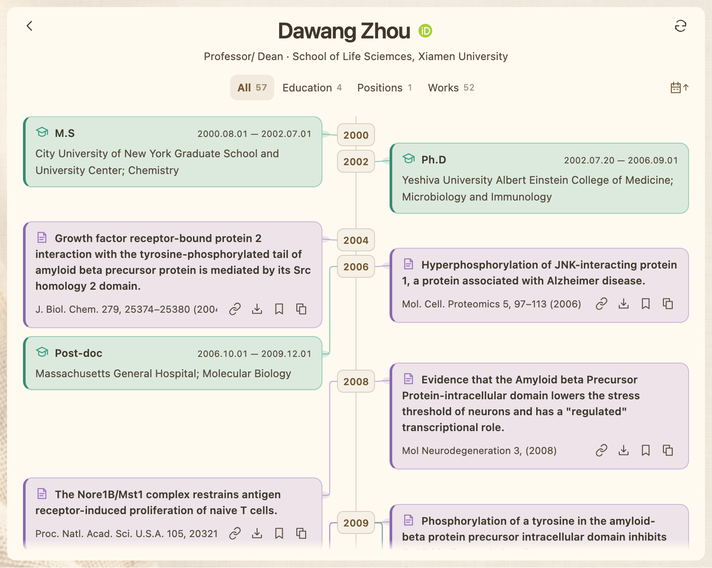
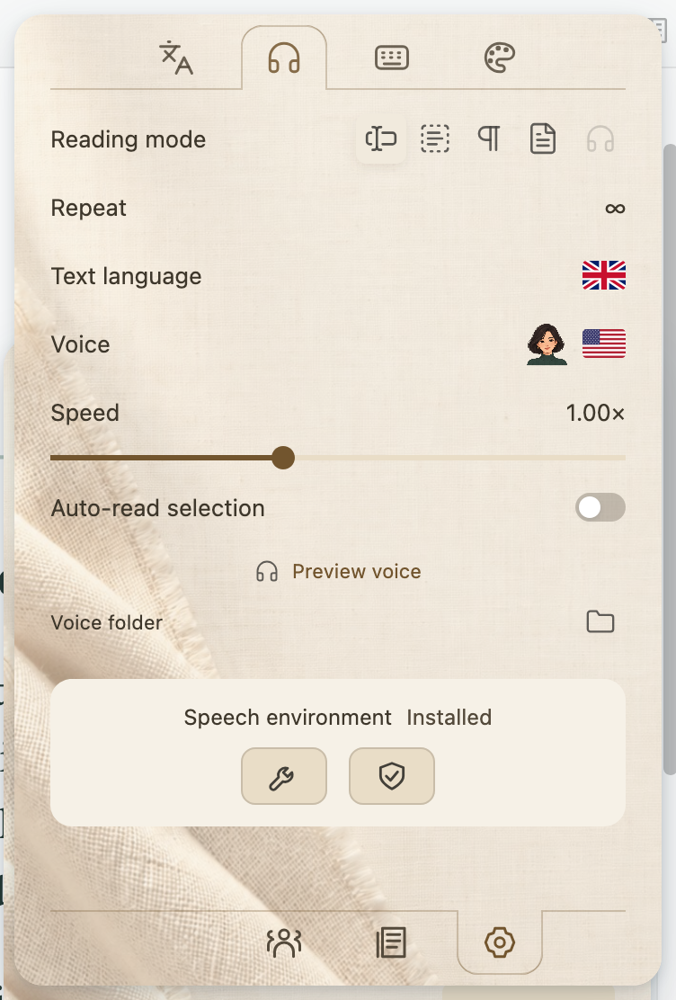

<h1 align="center">Paper Loom</h1>

<strong>Read. Listen. Follow the connections.</strong>

A reading companion for Zotero: offline speech, translation, references, and author discovery.

<a href="README.md">简体中文</a> · <a href="https://github.com/JunyanKang/paper-loom/releases/latest">Download XPI</a> · <a href="docs/GUIDE.en.md">User guide</a> · <a href="https://github.com/JunyanKang/paper-loom/issues">Feedback</a>

Paper Loom keeps the next step close to the paper you are reading. Listen to a difficult paragraph, compare its translation, inspect a cited paper’s abstract, save it for later, and explore the author’s collaborations without leaving Zotero.

## Get started

1. Download **paper-loom-1.0.1.xpi** from [the latest release](https://github.com/JunyanKang/paper-loom/releases/latest).
2. In Zotero, choose **Tools → Plugins → gear → Install Plugin From File…** and select the XPI. Restart if Zotero asks.
3. Click the **small book in the left toolbar**, then **Settings → Voices & engine → Download engine & voices**. Paper Loom detects your operating system and processor.
4. Open a PDF. Select text to listen, or click the floating book to open Settings. Bottom icons switch to papers and author networks.

One XPI installs the plugin. Speech is an optional in-plugin download; references, reading lists, translation, and author tools do not require it. You do not need Python, a terminal, or a separate application.

| Requirement | Support |
| --- | --- |
| Zotero | 10.0.5-beta.1 or newer 10.x; 11.x, including the current beta |
| Automatic voice download on Mac | Apple Silicon, macOS 14 or newer; about 494 MiB |
| Automatic voice download on Windows | Intel / AMD x64; about 482 MiB |
| Intel Mac, native Windows ARM, Linux | No bundled automatic voice download; import a compatible engine if available |
| Storage | Allow at least 3 GB free for download, extraction, and repair |

See [installation and updates](docs/INSTALL.en.md) for platform details, importing voices, and retrying a download.

## Read at your own pace

- **Selection, sentence, paragraph, and full text:** start at the right scale, repeat a sentence or paragraph, pause and resume, and move backward or forward.
- **Reading-aware text handling:** multi-column order, cross-page passages, citation markers, running headers, and configurable figure-caption reading.
- **Four speech languages, 14 voices:** English, Mandarin Chinese, Japanese, and French, including US and UK English choices. Natural-sounding local TTS, not human recordings.
- **Compact reading controls:** hover over the translation caption for two rows of playback, mode, and language controls. Click the floating book for Settings; customize shortcuts and restore your reading position.

## Understand a passage and its references

Compare source text and translation, translate abstracts, or listen to an abstract directly. Choose a built-in translation service or configure your own model provider. Translation choices and reading appearance are shared across these views.

Hover over supported in-text citations to inspect the referenced paper, locate its appearances in the PDF, check publication information, and open a local attachment or DOI. Save a paper to **Read later**, add it to Zotero, or copy a formatted citation.

[Listening, references, and reading-list guide →](docs/GUIDE.en.md) · [Translation and settings →](docs/SETTINGS.en.md)

## Explore authors and careers

The author network uses papers in your Zotero library. Search for an author or paper, focus on collaborators, inspect their shared papers, and return to the same graph position. Open a public ORCID career to browse education, employment, and works alongside the network.

*The career example uses the public ORCID record for Dawang Zhou. Public profiles may be incomplete; a missing entry does not mean an activity did not occur.*

[Author networks and careers →](docs/NETWORK.en.md)

## Make it comfortable

Use one settings center for reading and translation, themes, fonts, transparency, backgrounds, voices, and keyboard shortcuts. Pick a voice per language, adjust speed, and test the engine from the same page that downloads it.

## Data and connectivity

Speech synthesis, PDF text processing, and the basic local author network run on your computer. Translation sends text to the provider you select. Online metadata, journal information, and ORCID lookups contact their respective public services. There is no added telemetry, analytics, or Paper Loom account.

[Privacy and data](docs/PRIVACY.en.md) explains what is stored locally, which actions go online, and how to remove local data.

## Documentation

| I want to… | Read |
| --- | --- |
| Install, download voices, or update | [Installation](docs/INSTALL.en.md) |
| Listen, inspect citations, and organize a reading list | [User guide](docs/GUIDE.en.md) |
| Configure translation, appearance, and shortcuts | [Settings](docs/SETTINGS.en.md) |
| Explore collaborators and public careers | [Authors & careers](docs/NETWORK.en.md) |
| Fix a download, audio, PDF, or translation problem | [FAQ](docs/FAQ.en.md) |
| Understand local storage and online requests | [Privacy](docs/PRIVACY.en.md) |
| Build or contribute | [Contributing](CONTRIBUTING.en.md) |

[Release notes](CHANGELOG.en.md) · [Report an issue](https://github.com/JunyanKang/paper-loom/issues) · [MIT license](LICENSE) · [Third-party notices](NOTICE.md)
