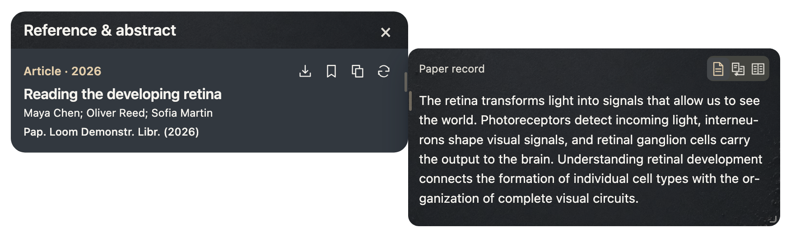
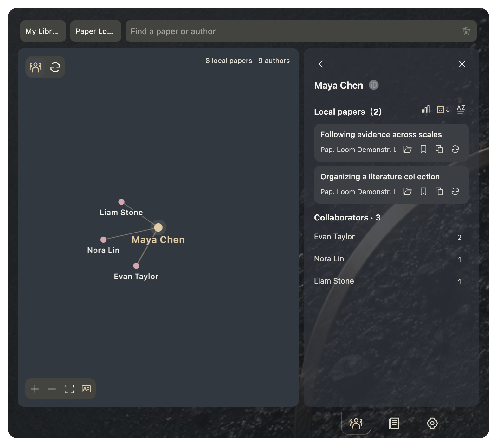
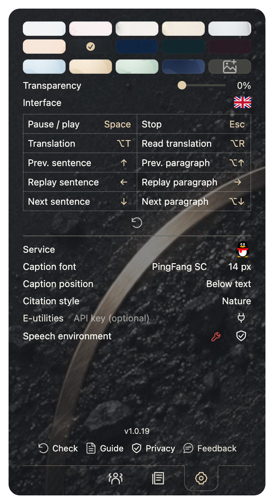

  

<a href="https://github.com/JunyanKang/paper-loom/releases/latest"><strong>Download Paper Loom</strong></a> · <a href="docs/INSTALL.en.md">Installation</a> · <a href="README.md">简体中文</a> · <a href="https://github.com/JunyanKang/paper-loom/issues">Feedback</a>

Listen to a difficult passage. Inspect the paper behind a citation. Save the next question for later.

**Paper Loom is a listening and literature companion for Zotero.** It brings offline speech, translation, reference previews, and author networks into your reading workflow.

## Start with this passage

  

Read a sentence, a selection, a paragraph, or the full text. Listen once, repeat a difficult passage, or choose a speed from 0.5× to 2×. Hover over the current source passage, translation, or controls to pause at the end of the sentence. Move away to continue.

Speech runs locally. After installing the voice package, listen offline in English, Mandarin Chinese, Japanese, or French. There are 14 voices, including US and UK English. Compare a translation beside the source or switch to reading the translation aloud.

## Follow the reference

  

Hover over a recognized citation to inspect its paper and abstract. Open a local attachment or DOI, copy a formatted citation, or add the paper to Read later. Abstracts offer original, translated, and bilingual views, with the same target language as passage translation.

Recognition depends on the PDF’s text structure. Scans and complex layouts may need manual lookup. If a source provides no abstract, Paper Loom leaves it missing.

## Find the people behind the papers

  

Explore co-authors and their shared papers in your Zotero library. Focus on an author, then open their public ORCID career to browse education, employment, and works.

The pictured graph uses a demonstration library. Your graph reflects your own collection and metadata; verify same-name authors against their papers and ORCID.

## Install and start reading

1. Download the **`.xpi`** from [Releases](https://github.com/JunyanKang/paper-loom/releases/latest). Leave it zipped.
2. In Zotero: **Tools → Plugins → gear → Install Plugin From File**.
3. Click the book to open Settings. Use the wrench beside **Speech environment** to install voices; the shield checks them.
4. Open a text-selectable PDF, select a passage, and click the headphones. Selection alone does not start playback.

References, translation, and author tools work without the voice package. The package includes its runtime, so you do not need to install Python.

| Requirement | Details |
| --- | --- |
| Zotero | Declared compatibility: 10.x from 10.0.5-beta.1 and 11.x. Beta changes can affect features. |
| Mac voices | Apple Silicon, macOS 14+, about 494 MiB |
| Windows voices | Intel / AMD x64, about 482 MiB |
| Other platforms | No automatic voice package yet |
| Free space | Allow at least 3 GB for download, extraction, and repair |

[Installation details →](docs/INSTALL.en.md)

## Make room for your way of reading

  

Themes, transparency, interface language, shortcuts, translation fonts, and citation styles share one page. Add a background image or configure your own model provider. Update, Guide, Privacy, and Feedback stay at the bottom.

## Your data

Speech synthesis and PDF text processing run on your computer. Translation sends text to your selected provider; online metadata and author lookups send the relevant query fields. Paper Loom requires no account and adds no telemetry or usage analytics. See [Privacy & data](docs/PRIVACY.en.md).

## Keep exploring

[User guide](docs/GUIDE.en.md) · [Settings](docs/SETTINGS.en.md) · [Authors & careers](docs/NETWORK.en.md) · [FAQ](docs/FAQ.en.md) · [Release notes](CHANGELOG.en.md)

The source is [MIT licensed](LICENSE). [Report an issue](https://github.com/JunyanKang/paper-loom/issues) or [contribute](CONTRIBUTING.en.md). Voice dependencies and third-party resources retain [their own licenses](NOTICE.md).
