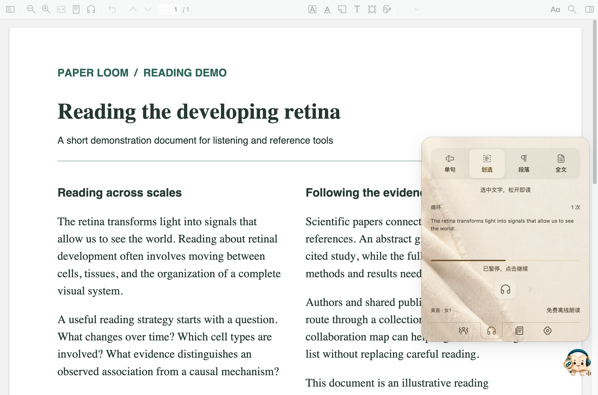
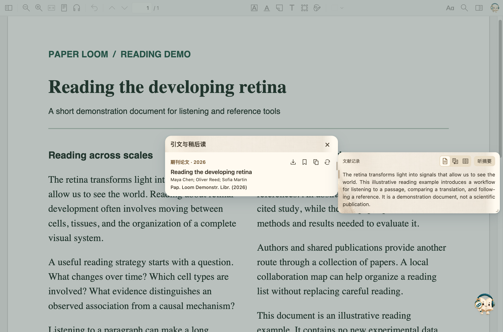
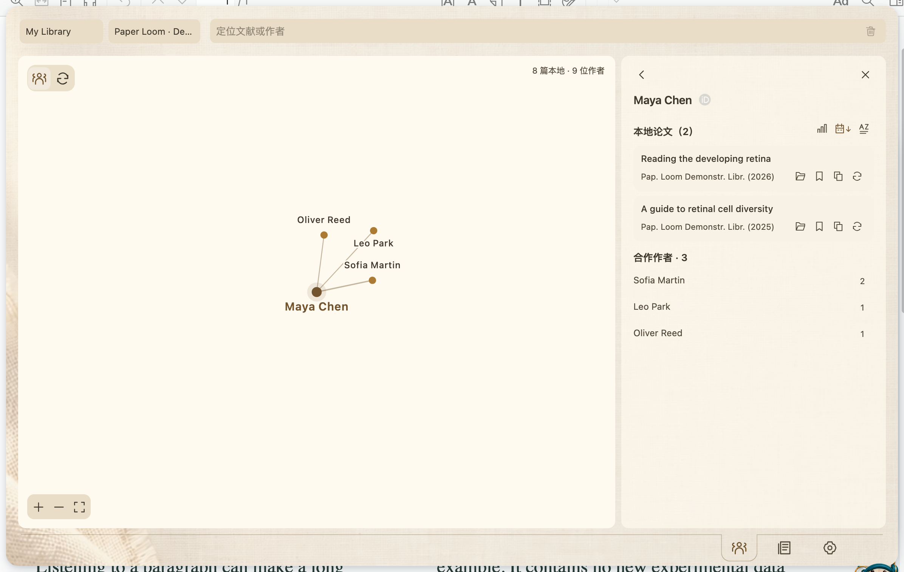
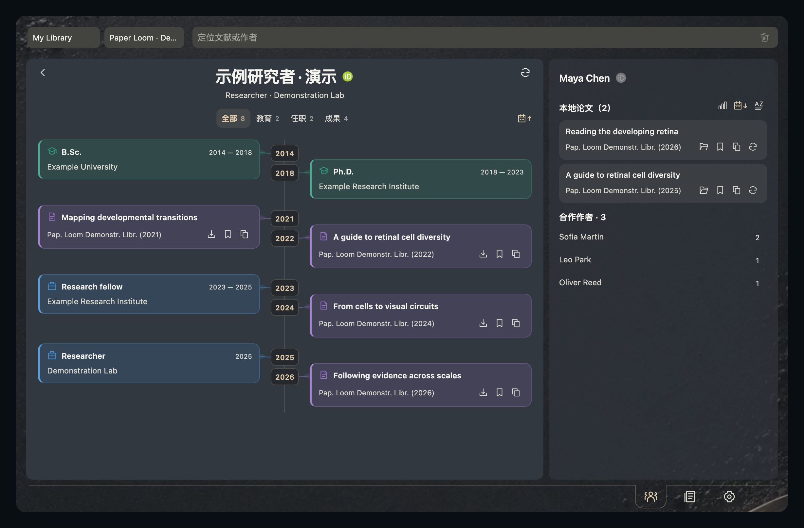

<h1 align="center">Paper Loom</h1>

<strong>听读论文，串起研究线索。</strong>

在 Zotero 中听读、翻译、查阅引文，探索作者与论文之间的联系。

<a href="README.en.md">English</a> · <a href="https://github.com/JunyanKang/paper-loom/releases/latest">下载 XPI</a> · <a href="docs/GUIDE.md">使用指南</a> · <a href="https://github.com/JunyanKang/paper-loom/issues">问题反馈</a>

Paper Loom 把阅读中需要的下一步放在手边：听一遍难懂的段落，对照译文，查看被引论文的摘要，存入稍后读，再沿着作者的合作关系继续探索。整个过程都在 Zotero 中完成。

## 开始使用

1. 从[最新版本](https://github.com/JunyanKang/paper-loom/releases/latest)下载 **paper-loom-1.0.1.xpi**。
2. 在 Zotero 中打开 **工具 → 插件 → 齿轮 → 从文件安装插件…**，选择 XPI；如提示，请重启 Zotero。
3. 点击**左侧工具栏的小书**，进入 **设置 → 声音与引擎 → 下载引擎与声音**。Paper Loom 会识别电脑系统和处理器，选择对应资源。
4. 打开 PDF，右下方会自动出现悬浮小书；划选文字即可听读，也可点击小书打开主窗口，通过右上角图标进入听读、引文、作者网络或设置。

插件只需安装一个 XPI。声音在插件内按需下载；引文、稍后读、翻译和作者工具不依赖声音包。无需安装 Python、使用终端或另装桌面程序。

| 使用条件 | 支持情况 |
| --- | --- |
| Zotero | 10.0.5-beta.1 及更新的 10.x；11.x（含当前测试版） |
| Mac 自动声音下载 | Apple Silicon，macOS 14 及以上；约 494 MiB |
| Windows 自动声音下载 | Intel / AMD x64；约 482 MiB |
| Intel Mac、原生 Windows ARM、Linux | 暂无自动声音下载；可导入兼容引擎 |
| 磁盘空间 | 建议至少预留 3 GB，用于下载、解压和修复 |

平台说明、声音导入和下载重试见[安装与更新](docs/INSTALL.md)。

## 按自己的节奏听读

- **划选、单句、段落、全文四种模式**：选择适合当前任务的范围，重复听读，随时暂停、继续，或跳到上一句、下一段。
- **面向论文的文本处理**：处理双栏阅读顺序、跨页段落、引文标记与页眉页脚，并可选择是否朗读图注。
- **四种语言、14 个音色**：支持英语、普通话、日语和法语，提供美音、英音及多种男女声音色。声音由本机自然语音合成生成，并非真人录音。
- **小巧的阅读伙伴**：悬停小书展开快捷控制，点击打开听读主窗口；可拖动位置、自定义快捷键，并恢复听读进度。

## 理解段落，也理解它的引文

查看原文与译文对照、翻译引文摘要，或直接听读摘要。可选内置翻译服务，也可配置自己的模型服务；这些场景共用翻译选择和阅读外观。

在支持识别的正文引文上悬停，可查看被引论文、定位其在 PDF 中的出现位置、检查出版信息，并打开本地附件或 DOI。感兴趣的文献可加入**稍后读**、保存到 Zotero，或复制指定格式的引用。

[听读、引文与稍后读指南 →](docs/GUIDE.md) · [翻译与设置 →](docs/SETTINGS.md)

## 从论文找到作者，从作者发现联系

作者朋友圈基于 Zotero 文献库中的论文建立。可搜索作者或论文、聚焦合作者、浏览共同发表的文献，并返回原来的网络位置。通过公开 ORCID，可在网络旁查看作者的教育、任职和作品时间线。

*履历示例来自 Dawang Zhou 的公开 ORCID。公开资料可能不完整，缺少某项记录不代表该经历不存在。*

[作者网络与学术履历 →](docs/NETWORK.md)

## 调整到舒服的阅读状态

在一个设置中心管理阅读与翻译、主题、字体、透明度、背景、声音和快捷键。按语言选择音色、调整语速，并在下载声音的同一页面检查引擎。

## 数据与联网

声音合成、PDF 文本处理和基础作者网络在本机完成。翻译会将文本发送给所选服务；在线文献、期刊信息和 ORCID 查询会访问相应公开服务。无需 Paper Loom 账号，无新增遥测或使用统计。

[隐私与数据](docs/PRIVACY.md)说明本地保存内容、何时联网，以及如何清理数据。

## 文档导航

| 我想…… | 查看 |
| --- | --- |
| 安装、下载声音或更新 | [安装与更新](docs/INSTALL.md) |
| 听读、查引文、整理稍后读 | [使用指南](docs/GUIDE.md) |
| 设置翻译、外观和快捷键 | [设置详解](docs/SETTINGS.md) |
| 探索合作关系和公开履历 | [作者与履历](docs/NETWORK.md) |
| 解决下载、声音、PDF 或翻译问题 | [常见问题](docs/FAQ.md) |
| 了解本地数据和在线请求 | [隐私与数据](docs/PRIVACY.md) |
| 自行构建或参与开发 | [参与开发](CONTRIBUTING.md) |

[更新记录](CHANGELOG.md) · [反馈问题](https://github.com/JunyanKang/paper-loom/issues) · [MIT 许可](LICENSE) · [第三方声明](NOTICE.md)
