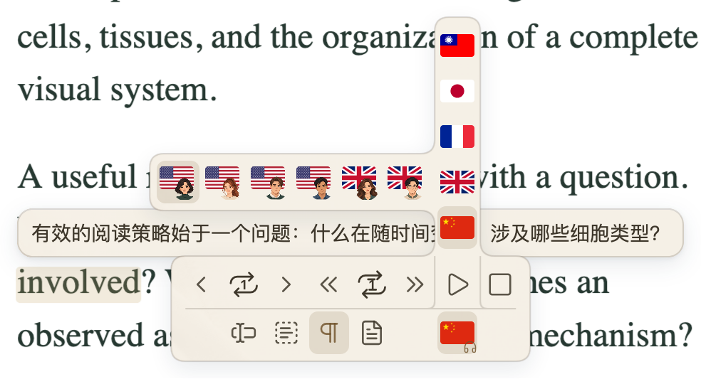
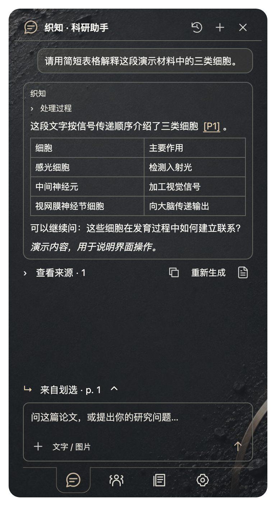
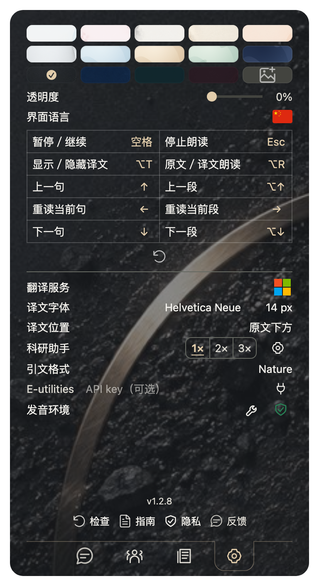

<h1 align="center">Paper Loom</h1>

<strong>在 Zotero 里读论文、追引文，把问题继续研究下去。</strong>

  

<a href="https://github.com/JunyanKang/paper-loom/releases/latest"><strong>下载插件</strong></a> · <a href="docs/INSTALL.md">安装</a> · <a href="docs/GUIDE.md">听读与翻译</a> · <a href="docs/ASSISTANT.md">AI 助手</a> · <a href="README.en.md">English</a>

Paper Loom 是一个开源 Zotero 插件，把**离线朗读、对照翻译、引文追踪、作者网络和 AI 科研对话**放在论文旁边。你可以听懂一个难句，查看它引用的研究，沿着作者关系找到下一篇论文，再把问题与阅读所得整理成笔记。

它从你正在读的内容出发：一段划选文字、一篇 PDF，或文献库里选中的几篇论文。原文、来源和研究问题始终有地方可以回去。

## 从阅读到研究，可以这样用

| 阅读中的问题 | 在 Paper Loom 中继续 |
| --- | --- |
| 这段太长，想换一种方式读 | 按句、划选、段落或全文朗读，调整语速，重复难句 |
| 外文读不顺，又想保留原文 | 在旁边看译文；正文与摘要共用目标语种 |
| 这句话引用的研究说了什么 | 悬停引文看文献卡、摘要和译文，打开原文或加入稍后读 |
| 这个领域有哪些相关作者 | 从本地收藏查看合作网络，聚焦作者及其公开履历 |
| 这组结果支持什么，下一步怎么做 | 和织知讨论论文、图表或多篇研究，沿来源核对，再保存笔记 |

## 先打开第一篇论文

1. 从[发布页](https://github.com/JunyanKang/paper-loom/releases/latest)下载 **`.xpi`**，不要解压。在 Zotero 的 **工具 → 插件 → 齿轮 → 从文件安装插件** 中安装。
2. 打开 PDF，把鼠标移到小书上展开面板。底部四个入口分别进入科研助手、作者网络、文献列表和设置。
3. 从眼前的问题开始：划选一段看译文，悬停一个引文查来源，或打开助手提问。单纯划选不会自动朗读。
4. 想听论文时，在设置的 **发音环境** 安装声音包；想与织知对话时，在 **科研助手** 配置自己的模型。

声音包与模型配置都按需启用。翻译、文献卡和作者网络不要求先安装声音；AI 助手的密钥也与大模型翻译分开保存。

插件声明支持 Zotero **10.0.5-beta.1 起的 10.x 与 11.x**。自动声音包提供 Apple Silicon Mac（macOS 14+）和 Windows x64 版本，包含运行环境，无需自行安装 Python。其他平台的声音支持、磁盘空间与旧版迁移见[安装指南](docs/INSTALL.md)。

## 让长论文按你的节奏展开

  

四种朗读范围适合不同读法：用**单句**听清术语，用**划选**读自己挑出的文字，用**段落**保留上下文，用**全文**连续往下读。默认段落模式、读一遍；句子和段落可以各自选择重读次数，语速从 0.5× 到 2×。

移到当前原文、译文或控制栏上，朗读会在句尾暂停，留出核对与操作的时间；移开后继续。手动暂停则由你决定何时恢复。

安装声音包后，合成在本机完成，可离线使用英语、普通话、日语和法语，共 14 个音色，英语区分美音与英音。译文可以显示在原文旁，也可以切换为译文朗读；可发音的语种会显示对应声音。

## 看译文，也看得见原文

  

划选内容、朗读字幕和文献摘要共用翻译目标语种。遇到不熟悉的方法，可以先对照翻译；需要核对术语，再回到原句。摘要支持原文、译文和双语视图，标题也随摘要一起翻译。

翻译服务可在总设置中选择，也可以接入自己的大模型。**界面语言、翻译目标和朗读声音分别设置**：换一种按钮语言不会改动论文内容，支持翻译的语种也不一定都有离线声音。

[查看听读与翻译操作 →](docs/GUIDE.md)

## 引文不必等到读完再查

  

把鼠标移到可识别的正文引文上，查看标题、作者、年份、入库状态和摘要。接着可以打开本地附件或 DOI、复制所选格式的引用，或把论文加入**稍后读**。

文献列表保留继续阅读的入口。摘要与译文就在同一套文献卡中，无需先复制题目，再到别处查询。织知回答里已确认的文献来源也使用这套卡片，让对话中的线索可以接回阅读。

扫描件需要 OCR，复杂分栏或异常编码也会影响识别。无法匹配的引文可以从列表手动查找；来源没有提供摘要时，界面会保留缺失状态。

## 从收藏看见作者之间的联系

  

“朋友圈与学术履历”从你的 Zotero 文献库和文献夹出发，把共同署名的作者与论文连起来。可以从总览进入局部网络，查看某位作者的本地论文，再访问公开 ORCID 履历中的教育、任职和作品。

这张图反映的是**你的收藏覆盖到的关系**。适合发现熟悉领域里的连接，也能帮助整理接下来想读的研究；同名作者仍需结合论文与 ORCID 核对。上图使用演示文献库。

[了解作者网络 →](docs/NETWORK.md)

## 织知：带着论文一起讨论

  
   当前界面，问答使用演示内容。

织知是 Paper Loom 的科研助手。它接住阅读中的问题，也把回答留在可以查回原文的地方。

**从当前内容开始。** 在 PDF 中打开助手，讨论这篇论文；从划选或朗读控件进入，带入当时的原文、译文与页码；从文献库选中 2–8 篇论文再开始，可以比较研究问题、方法和结果。已有对话保留原来的研究对象。

**按问题找材料。** 织知可检索相关原文、读取选定文献的索引文本、批注与笔记；支持看图的模型可查看 PDF 页面或你附上的图片。实时文献检索使用 Europe PMC 与 Crossref，通用网页搜索可另配 Brave。

**把回答接回研究。** 页码链接回到 PDF，已确认的文献引用可悬停打开文献卡。外部来源排在前面，本文页码放在一起。可以继续追问，预览后保存为 Zotero 子笔记，或从日历找回旧对话。

文字、表格、图片和简短处理进度都在所属消息框内。输入支持 Markdown、富文本粘贴和图片附件，图片以缩略图呈现，点击放大或下载；需要草拟示意图时，可另外配置兼容的生图模型。较宽的表格可把对话窗口调为 2× 或 3×。

模型、全文可用性和图像清晰度会影响回答。阅读片段不等于完整阅读，检索摘要也不等于验证结论；织知用于帮助理解和提出问题，关键判断仍要回到来源。

**[开始使用织知：配置、提问、看图与来源追溯 →](docs/ASSISTANT.md)**

## 适应你的工作方式

  

外观、界面语言、快捷键、译文字体、引用格式与模型入口集中在总设置。主面板共享主题和背景，字体与控件随界面语言保持统一。更新、指南、隐私和反馈固定在底部。

[查看设置说明 →](docs/SETTINGS.md)

## 哪些在本机，哪些会联网

| 功能 | 数据去向 |
| --- | --- |
| 离线朗读、PDF 文本处理、对话历史 | 在本机处理或保存；声音包首次下载需要网络 |
| 翻译 | 文字发送到你选择的翻译服务 |
| 文献、摘要与作者查询 | 相应的查询信息发送到在线来源 |
| 科研对话与看图 | 发送问题后，必要的上下文与图片提交给单独配置的助手模型 |
| 文字生图 | 发送明确的画图要求后，由配置的生图模型生成 |

Paper Loom 不要求注册插件账号，不添加遥测或使用统计。模型服务可能需要账号、API 密钥和费用；本地对话及图片不会自动随 Zotero 同步。详细说明见[隐私与数据](docs/PRIVACY.md)。

## 按你要做的事继续

| 文档 | 内容 |
| --- | --- |
| [安装与更新](docs/INSTALL.md) | 安装插件、声音包、检查更新与旧版迁移 |
| [听读与翻译](docs/GUIDE.md) | 阅读范围、语速、重读、译文与引文卡 |
| [织知使用指南](docs/ASSISTANT.md) | 模型配置、论文上下文、图像、检索、来源、历史与笔记 |
| [设置](docs/SETTINGS.md) | 外观、快捷键、翻译服务与助手入口 |
| [作者与履历](docs/NETWORK.md) | 网络范围、节点、作者身份与公开履历 |
| [常见问题](docs/FAQ.md) | 声音、识别、翻译和使用问题 |
| [更新记录](CHANGELOG.md) | 每个版本的变化 |

代码采用 [MIT 许可](LICENSE)，声音依赖与第三方资源适用[各自的许可](NOTICE.md)。欢迎[反馈问题](https://github.com/JunyanKang/paper-loom/issues)或[参与开发](CONTRIBUTING.md)。
