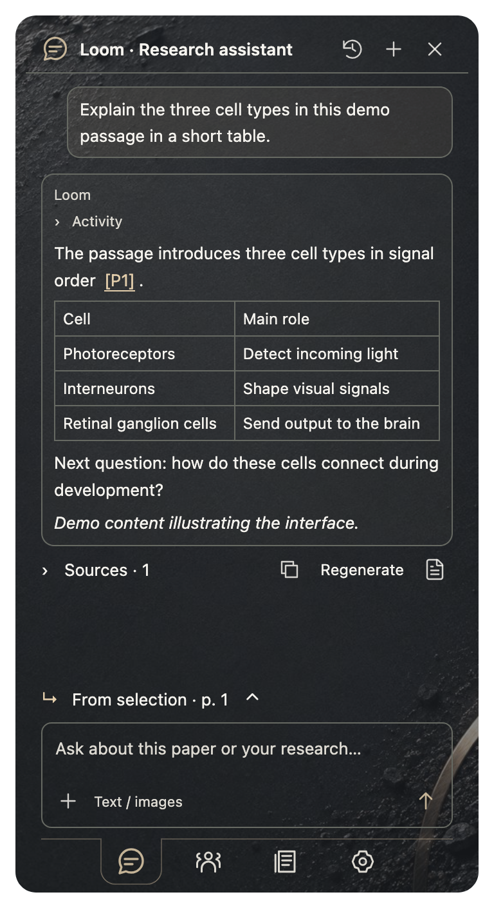
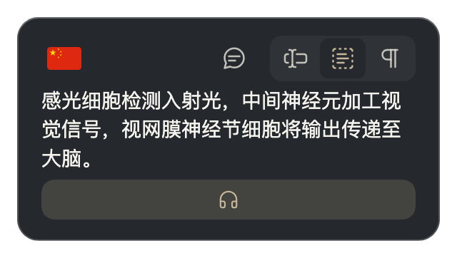
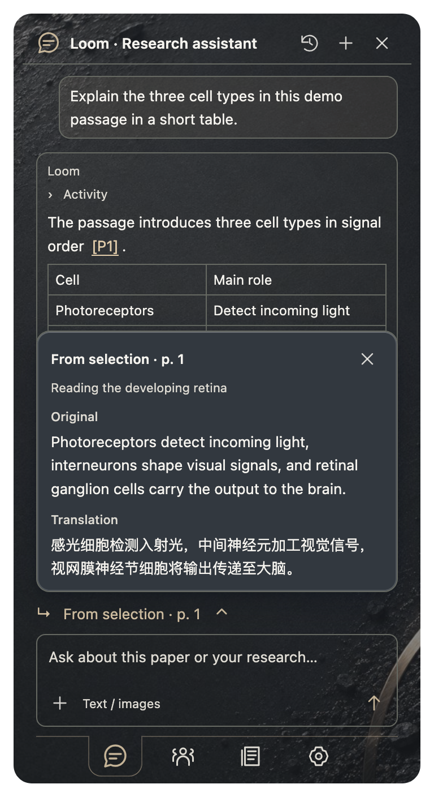
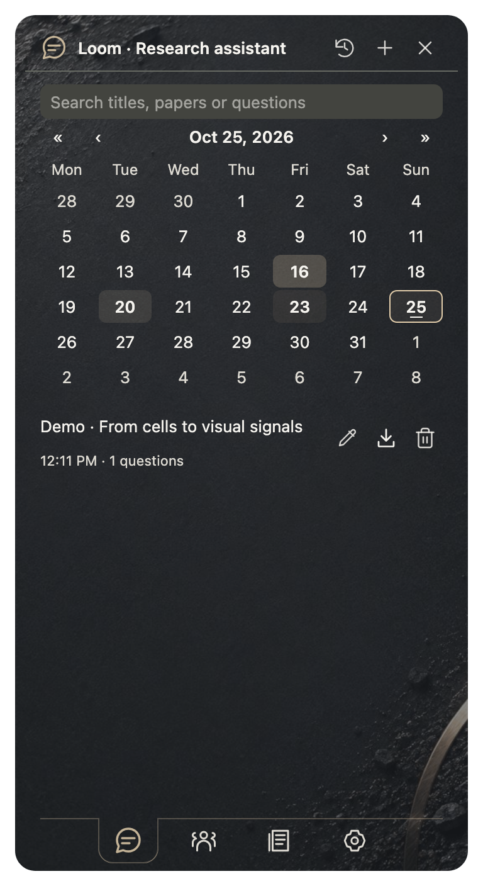

<h1 align="center">Loom · Research assistant</h1>

<strong>From a difficult sentence to a question worth pursuing.</strong>

<a href="../README.en.md">Meet Paper Loom</a> · <a href="SETTINGS.en.md">Settings</a> · <a href="PRIVACY.en.md">Privacy & data</a> · <a href="ASSISTANT.md">简体中文</a>

Loom puts a research conversation beside your papers in Zotero. Ask about a term, work through an experiment, compare studies, or find new references. Page links and literature cards lead back to the sources; useful answers can become Zotero notes.

  
   Demo conversation: the table and citation remain inside the answer.

For a first conversation, connect a model below, open a PDF, and ask a specific question. You do not need the voice package to use the assistant.

| What you want to do | Start here |
| --- | --- |
| Connect your model | [Model setup](#model-setup) |
| Discuss one paper or compare several | [Choose the material](#choose-the-material) |
| Get more useful answers | [Ask a focused question](#ask-a-focused-question) |
| Read figures or draft an illustration | [Text and images](#text-and-images) |
| Check citations and discover research | [Follow the sources](#follow-the-sources) |
| Find conversations and save notes | [Keep what you learn](#keep-what-you-learn) |
| Resolve a problem | [Troubleshooting](#troubleshooting) |

## Model setup

Open the book panel and choose **main Settings → Research assistant**. The configuration window follows the model-translation layout, but the two sets of providers, models and credentials are stored separately. Changing the assistant does not change translation.

1. Choose a provider, check its endpoint, and enter an API key.
2. Select or enter a chat model. Refresh the list if needed; if the model is absent, enter the exact name supplied by the provider.
3. Enable **Vision** only when the model accepts image inputs.
4. Choose **Save and test**, then return to the assistant and start a conversation.

OpenAI-compatible interfaces and Anthropic Messages are supported. Provider presets help fill addresses; they do not give every model the same capabilities. Pricing, quotas and regional availability are determined by the provider.

| Setting | When it is needed |
| --- | --- |
| Chat model and key | Text questions, paper discussions and tool use |
| Vision | Reading PDF pages as images or analyzing attachments; the model must support it |
| Brave Search key | General web search; Europe PMC and Crossref literature searches need no extra search key |
| Image model | Optional illustration generation through a compatible Images API on the assistant endpoint and key |

The image model is separate from the chat model. Leaving it blank does not affect text or vision and prevents image-generation requests. After a successful connection test, ask a short question to check the conversation and tools you intend to use.

## Choose the material

  
   Enter from the conversation bubble beside a selection.

  
   The reading entry brings the current passage.

The entry point determines the material automatically; there is no separate current-paper or comparison selector.

| Where you enter | Material for a new conversation |
| --- | --- |
| The book panel in an open PDF | The current paper and accessible text |
| The conversation icon beside a selection or reading controls | The passage, translation and page, linked to its paper |
| The library with one paper selected | That item and its available material |
| The library with 2–8 papers selected | Those papers as a comparison context |

**An existing conversation keeps its original papers.** After changing the paper or library selection, choose New conversation to detect the material again. This lets you look elsewhere and return to the question you were discussing.

A new comparison question entered from a PDF can also use multiple library selections when they include that paper. For an explicit comparison scope, select 2–8 papers in the library first, then start a new conversation.

Loom retrieves passages relevant to the question and can read further pages, indexed text, annotations or notes as needed. Opening the assistant does not upload the entire PDF. Sending a question submits the material needed to answer it. Long papers and conversations have context limits: associating a paper with a chat does not mean every page is read on every turn.

From a selection or reading entry, **From selection / From reading · page** appears above the input. Click it to preview the original passage, translation and paper title above the composer; click outside or press Esc to close. The same conversation retains this passage until you enter from another selection or reading passage.

  

## Ask a focused question

A small question does not need a long prompt. For comparisons and experimental design, name the studies and the difference you care about.

| Reading task | Try asking |
| --- | --- |
| Explain a passage | “What does lineage priming mean here? Explain it in context, then summarize it in one sentence.” |
| Understand an experiment | “Which experiment supports a cell-autonomous effect? What is the key control, and which alternative explanations does it address?” |
| Inspect a figure | “Look at Figure 3b. What do the axes, groups and error bars represent, and which part of the argument does it support?” |
| Compare papers | “Compare the subjects, intervention timing and endpoints of these three papers in a short table. Why might their conclusions differ?” |
| Find recent literature | “Find original research since 2023 on retinal vascular development. Include DOIs and explain how each study relates to this paper.” |
| Use annotations | “Use my annotations on this paper to identify two unresolved questions. Distinguish the paper’s evidence from my own ideas.” |
| Plan follow-up work | “Suggest two experiments that could distinguish this mechanism from alternative explanations, with controls and expected outcomes.” |

Loom’s built-in role focuses on the relationship between experiments, controls and interpretation. You can still request a shorter answer, a different language or one panel only. Figure numbers and PDF pages may differ; include the page if you know it.

Before the answer arrives, short muted updates appear inside that reply, such as reading the paper, finding sources or preparing the answer. They fold on completion and can be reopened. These are activity summaries, not a transcript of the model’s hidden reasoning.

## Follow the sources

Ask for a literature search when you need new references. Europe PMC and Crossref find papers; a configured Brave key adds general web search. Coverage and network availability affect results. Finding an abstract does not mean the full text has been obtained or read.

Sources provide two paths back to reading:

- **Return to the paper.** Click a page link to open the PDF. Pages from the same paper share a compact row. Links use one-based PDF page indices, which may differ from printed page numbers.
- **Open a reference.** Hover over a confirmed citation to see the Paper Loom card, with its abstract, translation, library status, original article, citation copying and Read later actions.

Sources lists external material first, then groups local pages by paper. The disclosure button and adjacent actions stay in place when expanded.

An author, year or number in ordinary prose does not always identify a confirmed source. A paper’s internal reference numbers also require its bibliography. If a number has no hover card, open the source PDF and return to the conversation, or ask for the full title or DOI and use the paper list. Ambiguous numbers across different papers remain text.

For an important conclusion, follow the page link to the experiment and then inspect its references. This helps uncover missing conditions rather than simply collecting a list of citations.

## Text and images

### Format without filling the screen

Type Markdown or paste formatted text directly. Bold, italic, lists, quotations and tables render inside the sent message; there is no formatting toolbar to open. Ctrl/Cmd+B and Ctrl/Cmd+I format selected text; Enter sends and Shift+Enter adds a line. Confirming an IME candidate does not send the message.

Questions and answers use slightly different theme tints. Text, tables, images and activity remain inside their own message bubbles. For wider tables, choose **1×, 2× or 3×** under **main Settings → Research assistant**. The default matches Settings; larger widths remain capped to the current window.

### Ask about a figure

Use **＋** at the lower left of the input, paste, or drag in one PNG, JPEG or WebP per message, up to 8 MB. Before sending, its longest edge is reduced to at most 1,600 pixels. The message retains a thumbnail; click it to enlarge and download. A conversation can retain up to 12 images.

For tiny axes, dense labels or multi-panel figures, attach the relevant area and name the panel and question. With Vision enabled on a compatible model, you can also ask it to inspect a PDF page. A caption alone supports a discussion of its text, not claims about an unseen curve or an exact measurement.

**Earlier images remain visible in history but are not automatically resent with every follow-up.** To inspect an old image again, attach it again or ask Loom to reread the PDF page.

### Draft an illustration

After configuring an image model, explicitly ask for an illustration and send the message. No separate mode is needed. For example: “Draw a simple four-stage experimental workflow: sampling, grouping, treatment and imaging.” Generation normally submits only that description. If you explicitly refer to the current passage or previous answer, it also includes the entry passage, or otherwise the latest complete answer, falling back to the paper abstract; this reference is capped at 12,000 characters. It does not automatically send the full paper or entire history.

The result is stored as a thumbnail inside an assistant message, with enlargement and download. This supports text-to-image, not editing an attached image. Remove any pending attachment before generating.

The provider must support an OpenAI-compatible Images API and return base64 image data. Anthropic Messages or an ordinary chat endpoint does not automatically provide this capability. External image URLs in answers are not downloaded automatically. Illustrations can help express an idea; they are not experimental data. Check their labels and scientific relationships before use.

## Keep what you learn

### Return through the calendar

  

Open History, adjust the year and month with the navigation buttons, and select a day. More questions give that day a darker background. A conversation continued across days appears on each day with activity. Search narrows records by title, paper information and recorded question summaries.

Open a record to continue; returning preserves the selected date and search. Rename, export as Markdown or delete a conversation. A specific research question makes a better title for finding it later than “paper discussion.”

### Save an answer to Zotero

Choose Save note in an answer’s actions, review the preview, and confirm the target paper. The target must be an editable parent item; the answer becomes its child note. Saving the same answer again does not create another identical note.

Markdown exports and Zotero notes currently contain **text and sources**. Download images separately from the enlarged view and add them to your own documents as needed.

### Where records live

Conversations and their associated images are stored in `paper-loom/assistant/` inside the Zotero data directory. They do not automatically sync with Zotero items. Back up this directory before moving computers. Deleting a conversation deletes its attached images too, so export anything you need first.

Chat does not automatically modify library items. The model provider receives the submitted question and necessary material; API keys do not enter conversation files or exports. See [Privacy & data](PRIVACY.en.md) for the complete data flow.

## Troubleshooting

| What happens | What to check |
| --- | --- |
| Connection failure or 401 | Endpoint, complete API key and model permissions; a Key ID is not the key |
| 429 or quota warning | Provider quotas and rate limits; retry later. Free models can also be rate-limited |
| Text works, images do not | Model image support and the Vision setting; try another model or a smaller image |
| The wrong paper informs an answer | The conversation may retain an earlier scope; select the material and start a new chat |
| Only a title or abstract is available | PDF availability, extractable text or OCR; indexing and full-text access affect retrieval |
| A citation has no hover card | Whether the source is identified and the PDF bibliography is available; look up its full title or DOI |
| Image generation fails | Separate image-model configuration, endpoint and base64 support; a chat test does not test generation |
| A long conversation forgets early details | Restate key constraints or begin a focused new chat; context has a length limit |

If a problem remains, [report it](https://github.com/JunyanKang/paper-loom/issues) with the plugin version, model name, error and steps. Omit API keys and paper content you are not permitted to share.

<a href="../README.en.md">Back to Paper Loom</a> · <a href="GUIDE.en.md">Listening & translation</a> · <a href="SETTINGS.en.md">Settings</a>

