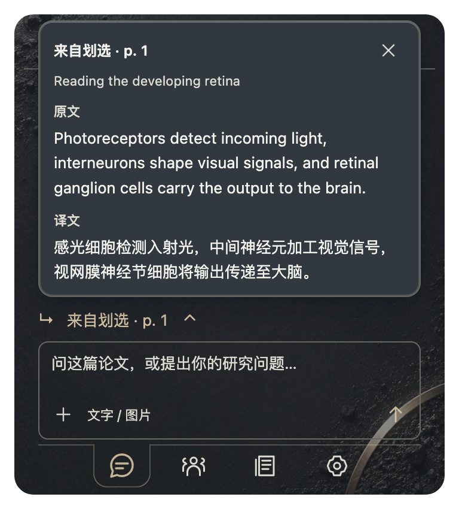
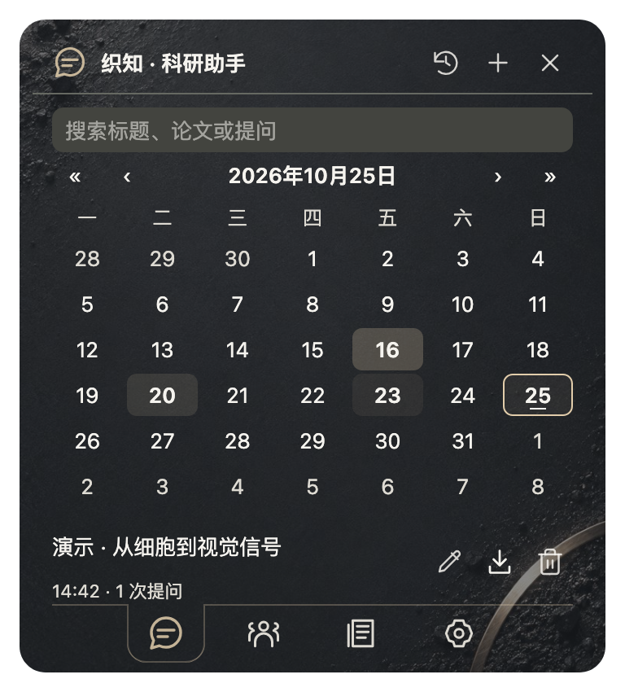

<h1 align="center">织知 · AI 科研助手</h1>

<strong>从读不懂的一句话，到值得继续研究的问题。</strong>

<a href="../README.md">认识 Paper Loom</a> · <a href="SETTINGS.md">设置</a> · <a href="PRIVACY.md">隐私与数据</a> · <a href="ASSISTANT.en.md">English</a>

织知把对话放在 Zotero 的论文旁边。你可以请它解释一个术语、梳理实验逻辑、比较几篇研究，或寻找新的参考文献。回答中的页码和文献卡帮助你回到来源，有价值的讨论可以整理成 Zotero 笔记。

  
   演示问答：表格和引用留在回复框内。

第一次使用，先完成下面的模型连接，再打开一篇 PDF，问一个具体问题。声音包不是使用助手的前提。

| 想做什么 | 从这里开始 |
| --- | --- |
| 接入自己的模型 | [连接模型](#连接模型) |
| 讨论当前论文或比较多篇研究 | [选择讨论材料](#选择讨论材料) |
| 找到更有用的提问方式 | [把问题问具体](#把问题问具体) |
| 看图与附图 | [文字与图片](#文字与图片) |
| 核对引用、查找新文献 | [沿着来源继续读](#沿着来源继续读) |
| 找回讨论、保存笔记 | [留下阅读所得](#留下阅读所得) |
| 连接或回答不正常 | [遇到问题时](#遇到问题时) |

## 连接模型

打开小书面板，进入**总设置 → 科研助手**。配置窗口沿用大模型翻译的布局，但两套服务、模型和密钥分别保存；调整助手不会改动翻译配置。

1. 选择服务商，核对接口地址，填写 API 密钥。
2. 选择或填写聊天模型。可以刷新列表；列表未列出时，使用服务商给出的准确模型名称。
3. 只有模型确实支持图像输入时，才开启**看图**。
4. 点击**保存并测试**。连接成功后，回到助手页开始对话。

支持 OpenAI 兼容接口和 Anthropic Messages。服务商预设方便填写地址，不代表其所有模型都具备相同能力；费用、额度和地区限制以服务商为准。

| 配置项 | 什么时候需要 |
| --- | --- |
| 聊天模型与密钥 | 文字问答、论文讨论和工具调用 |
| 视觉能力 | 查看 PDF 页面、分析附加图片；模型本身必须支持 |
| Brave Search 密钥 | 通用网页搜索；Europe PMC、Crossref 文献检索不需要额外搜索密钥 |

连接测试通过后，仍建议用一个简短问题确认所选模型能够正常对话和调用所需工具。

## 选择讨论材料

  
   从划选译文的对话气泡进入。

  
   从朗读控件进入时，带入当前句段。

助手根据入口自动确定材料，不需要再选“当前论文”或“比较文献”。

从划选或朗读进入时，输入框上方会显示 **来自划选 / 来自朗读 · 页码**。点击向上展开原文、译文和论文标题，核对后点击外部或按 Esc 收起。继续同一对话时保留这个入口片段；从另一处划选或朗读重新进入，则更新为新文段。

  

| 从哪里进入 | 新对话使用什么材料 |
| --- | --- |
| 当前 PDF 的小书面板 | 当前论文及其可读取的文本 |
| 划选译文或朗读控制栏的对话图标 | 当时的原文、译文与页码，并关联所属论文 |
| 文献库选中一篇论文后进入 | 该论文的条目信息和可用材料 |
| 文献库选中 2–8 篇论文后进入 | 这些论文的比较上下文 |

**已有对话保留原来的研究对象。** 换了论文或文献库选择后，点击“新对话”才会重新确定材料。这样，你可以切到别处查资料，再回来接着原来的问题讨论。

从 PDF 开始新的比较问题时，如果文献库多选中包含当前论文，助手也可使用这组选择。要明确比较范围，最直接的做法仍是先在文献库选好 2–8 篇，再开始新对话。

助手会按问题查找相关片段，必要时进一步读取页面、索引文本、批注或笔记。打开助手不会自动上传整本 PDF；发送问题后，回答所需的内容才会提交给模型。长论文与长对话有上下文上限，不能把“关联了论文”理解为每次都完整读取了所有页面。

## 把问题问具体

小问题可以直接问，不必写很长的提示词。涉及多篇论文或实验设计时，补上比较对象和你关心的差异，通常更容易得到有用的回答。

| 阅读场景 | 可以这样问 |
| --- | --- |
| 解释一个难句 | “这里的 lineage priming 指什么？请结合前后文解释，再用一句话概括。” |
| 理解实验逻辑 | “作者用哪个实验支持细胞自主作用？关键对照是什么，还排除了哪些替代解释？” |
| 看一幅图 | “请看 Figure 3b：横纵轴、组别和误差线分别是什么？这幅图支持了哪一步结论？” |
| 比较研究 | “比较这三篇论文的研究对象、干预时间和主要终点，用简短表格说明结论为什么不同。” |
| 查近期文献 | “查找 2023 年以来关于视网膜血管发育的相关研究，优先原始研究，给出 DOI 和与本文的联系。” |
| 利用阅读笔记 | “结合我在这篇论文的批注，列出还没解决的两个问题，并区分论文证据和我的想法。” |
| 准备后续实验 | “如果要检验这个机制，请提出两个可区分替代解释的实验，说明对照和预期结果。” |

织知的内置角色关注实验依据、对照和解释之间的关系。你仍可以要求更短的回答、换一种语言，或只讨论某个图版。文中的图号与 PDF 页码可能不同；知道页码时一起写出，可以减少查找时间。

回答生成前，当前回复框内会显示灰色的简短进度，例如读取论文、查找来源、整理回答。完成后自动收起，点击可再查看。这里记录的是处理步骤摘要，不是模型内部推理的逐字记录。

## 沿着来源继续读

需要新的参考文献时，可以直接要求检索。Europe PMC 和 Crossref 用于查找论文；配置 Brave 后，还能搜索一般网页。检索范围取决于来源覆盖和网络状态，找到摘要并不代表已取得或读过全文。

回答中的来源有两条回路：

- **回到论文：** 点击页码定位 PDF。同一篇论文的页码集中排列，避免反复占行。这里使用从 1 开始的 PDF 页序，可能与纸面印刷页码不同。
- **打开文献：** 悬停已确认的引用，显示 Paper Loom 文献卡，可继续查看摘要与译文、入库状态、打开原文、复制引用或加入稍后读。

“查看来源”优先列出外部资料，再按论文汇总内部页面。展开时，来源按钮和相邻操作保持在原位。

普通文字里的作者名、年份或数字不一定都能变成文献卡。引用需要对应到明确来源；原论文的参考文献编号还需要读取其文末列表。遇到不能悬停的编号，先打开源 PDF，再返回对话；也可以让助手给出完整题目或 DOI，并到文献列表查找。多篇论文中含义冲突的编号会保留为文字。

核对关键结论时，沿页码看实验本身，再查看相关参考文献。这样更容易发现回答遗漏的条件，而不只是收集一串引用。

## 文字与图片

### 写清楚，也保持紧凑

直接输入 Markdown，或粘贴带格式的文字；粗体、斜体、列表、引用和表格会在发送后显示于消息框内，不需要开启格式工具栏。Ctrl/Cmd+B 与 Ctrl/Cmd+I 设置所选文字；Enter 发送，Shift+Enter 换行。输入法确认候选词不会发送消息。

问答使用略有区别的主题底色。正文、表格、图片及处理进度都在所属消息框内部，图片不会散落在对话之外。需要更宽的表格时，在**总设置 → 科研助手**选择 **1×、2× 或 3×**；默认与设置窗口等宽，放大后仍受当前窗口宽度限制。

### 请助手看图

点击输入框左下角的 **＋** 选择图片，也可以粘贴或拖入图片，每条消息可附一张 PNG、JPEG 或 WebP，文件不超过 8 MB。发送前最长边缩至不超过 1,600 像素。缩略图留在消息中，点击可放大查看和下载；每个对话最多保留 12 张图片。

分析细小坐标、密集标注或多面板图时，优先附上需要讨论的局部，说明图号和问题。开启视觉且模型支持时，也可以请助手读取指定 PDF 页面。只有图注而没有看到图像时，应按图注内容讨论，不能据此声称读出了曲线或精确数值。

**历史图片保留在界面中，但不会在每次追问时自动重新发送。** 若希望重新检查某张旧图，请再次附图，或请助手重新读取对应 PDF 页面。

## 留下阅读所得

### 日历找回对话

  

打开历史，用前后按钮调整年份与月份，选择日期查看当天的记录。当天提问越多，日历底色越深；跨天继续的对话会出现在各自有活动的日期。搜索可按标题、论文信息和已记录的问题摘要缩小范围。

点开记录继续讨论，返回时保留所选日期与搜索状态。可以改名、导出 Markdown 或删除对话；用一个具体的研究问题命名，往往比“论文讨论”更容易找回。

### 保存到 Zotero

在回答的操作区选择保存笔记，先预览，再确认目标论文。需要可写入的父文献条目；保存后成为其子笔记。同一条回答重复保存不会再创建一份相同笔记。

Markdown 导出与 Zotero 笔记目前保留**文字和来源**。图片请在放大视图中单独下载，再按需要加入自己的文档。

### 记录存在哪里

对话与图片保存在 Zotero 数据目录的 `paper-loom/assistant/` 中，图片与记录关联存储。它们不会自动随 Zotero 条目同步；换机前请备份该目录。删除对话也会删除其附图，操作前先导出需要的内容。

聊天内容不会自动写回或修改文献。模型服务会收到发送的问题和回答所需材料；API 密钥不写进对话或导出文件。完整数据流见[隐私与数据](PRIVACY.md)。

## 遇到问题时

| 情况 | 先检查这里 |
| --- | --- |
| 连接失败或 401 | 服务地址、完整密钥和模型权限；不要把 Key ID 当作密钥 |
| 429、额度或频率提示 | 服务商额度与并发限制，稍后重试；免费模型也可能限流 |
| 能聊天，不能看图 | 模型是否支持图片，以及视觉是否开启；必要时换模型或缩小图片 |
| 回答没有用到预期论文 | 当前对话是否仍绑定旧材料；重新选择后开新对话 |
| 只读到题目或摘要 | PDF 是否可用、有可提取文本或 OCR；索引和全文可用性会影响读取 |
| 引用不能悬停 | 是否有明确来源、源 PDF 文末参考文献是否已读取；按完整题目或 DOI 查找 |
| 很长的对话遗漏早期细节 | 重述关键条件，必要时另开有明确主题的对话；上下文有长度上限 |

仍有问题时，通过[反馈入口](https://github.com/JunyanKang/paper-loom/issues)提供插件版本、模型名称、错误提示和复现步骤。不要附 API 密钥或未经允许分享的论文内容。

<a href="../README.md">回到产品介绍</a> · <a href="GUIDE.md">听读与翻译</a> · <a href="SETTINGS.md">调整设置</a>

