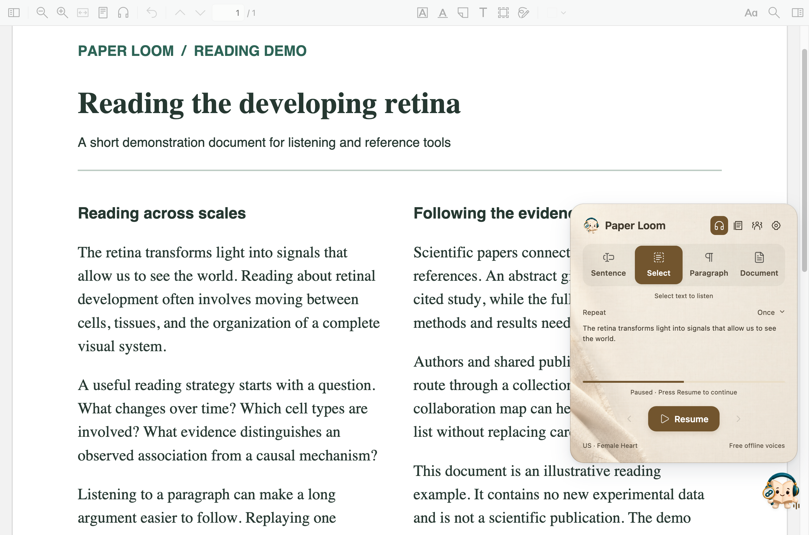

# User guide

[Home](../README.en.md) · [简体中文](GUIDE.md)

## Open and collapse

Click the book in the library toolbar or the lower-right corner of a PDF to open the listening window directly. The upper-right headphones, papers, authors, and gear icons open listening, references and the reading list, author networks, and settings. Hover over an icon for its name. All four main windows share these icons, with a soft tinted background for the current function. Each page keeps its own controls below the header. Click outside the workspace in Zotero or the PDF, click the book again, or press Esc to collapse. Hover over the book for listening shortcuts and drag to reposition it.

Each document shows one expanded main panel at a time: listening, references, network, or settings. Switching panels collapses the previous one without stopping speech. Reopening references or the network resumes the existing view. PDF tabs and separate reader windows keep their own panel states. Detail and editing dialogs open above their parent and return to it when closed.

## Choose a reading scope

| Mode | How to use it |
| --- | --- |
| Selection | Select PDF text; release to start listening if automatic reading is enabled |
| Sentence | Select text within a sentence to hear the complete sentence; replay it as needed |
| Paragraph | Select within a paragraph to hear the full paragraph and set repeats |
| Full text | Read from the beginning, a selected position, or saved progress |

Pause, resume, stop, or navigate to the previous/next sentence or paragraph. Adjust speed, repeats, and voice in the panel and voice settings. You can disable automatic selection reading in Settings.

The PDF must contain extractable text. OCR scanned pages first. Complex tables, equations, and unusual layouts may not read as expected. Text processing handles citation markers and running headers; figure-caption reading is configurable.

## Compare a translation

Enable translation display to compare the source and translated text. Enable **Read translation** separately when you want spoken translation. The translation target and interface language are separate choices. Targets without a bundled voice can still be displayed. Online translation requires connectivity; built-in services may rate-limit requests, or you can use your own model provider.

## Inspect in-text citations

Hover over supported numeric or author–year citations to inspect the referenced paper. Locate occurrences, open a local paper or DOI, or copy a formatted citation. Recognition depends on the PDF’s text structure. If it fails, open the reference panel or search by DOI/title.

Click or hover a paper title to expand its abstract. Abstracts support translation, source comparison, and listening. If an abstract is missing locally, query online metadata where offered. Paper Loom does not invent an abstract when a source has none.

## Read later and save

Add interesting papers to **Read later** and return to the list directly from your library, without opening a PDF. Open papers, inspect abstracts, copy citations, or save entries to Zotero. Check the title, authors, year, and DOI before saving: similar candidates are not necessarily the same paper.

Removing an entry from Read later does not delete the corresponding Zotero paper. Full-text access still depends on publisher permissions; Paper Loom does not bypass paywalls or sign-in requirements.

Continue with [Settings](SETTINGS.en.md), [Authors & careers](NETWORK.en.md), or the [FAQ](FAQ.en.md).
