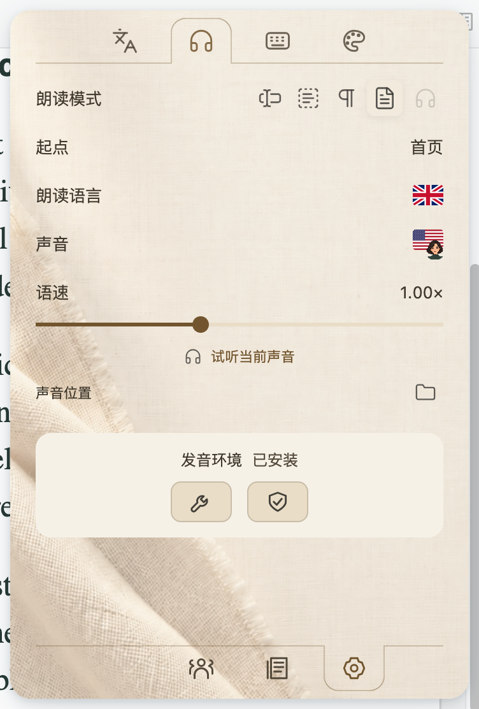

# 安装与更新

[首页](../README.md) · [English](INSTALL.en.md)

## 安装插件

下载[最新发布页](https://github.com/JunyanKang/paper-loom/releases/latest)的 `.xpi` 文件；不必解压，也不要下载 Source code 代替插件。在 Zotero 的「工具 → 插件」中点击齿轮，选择「从文件安装插件…」。安装后左侧工具栏会出现小书；工具菜单也可打开 Paper Loom。

需要 Zotero 10.0.5-beta.1 或更新的 10.x，或 11.x。更旧的 Zotero 版本需要先升级。安装不会修改原有文献、附件或其他无关插件。

## 下载离线声音

打开「设置 → 声音与引擎」，点击「下载引擎与声音」。系统与架构由插件识别：Apple Silicon Mac（macOS 14+）使用 Mac 引擎，Intel/AMD x64 Windows 使用 Windows 引擎。下载包含英语、普通话、日语和法语的全部音色。

Mac 下载约 494 MiB，Windows 约 482 MiB；建议预留至少 3 GB。下载进度会显示在页面中，可取消、继续或重试。完成后插件会合成一段声音检查引擎，再启用新声音。点击「试听」听取当前语言和音色。

Intel Mac、原生 Windows ARM 和 Linux 暂无对应的自动声音包；文献、翻译和作者功能仍可使用。在 Windows ARM 上运行 x64 模拟程序也不作为原生支持承诺。

## 使用已有声音

在声音页点击文件夹按钮，选择包含 `worker.py`、`python` 和 `models` 的兼容引擎目录，按提示检查。普通 MP3、WAV 或单个模型文件不能当作引擎目录。导入不需要重新下载全部声音。

## 更新与修复

设置页底部可手动检查更新，并选择每天、每周或每月检查。是否自动安装由 Zotero 的插件更新设置控制。更新插件不会重新下载未变化的声音包。

声音出错时先点击「检查当前声音」。下载中断可点「继续下载 / 重试」；需要修复时使用「重新下载 / 修复」。只有新引擎通过检查后才会替换当前使用路径。

## 已有配置与卸载

如检测到 Paper Voice 或 Paper Nexus 仍在运行，Paper Loom 会提示导入并停用旧插件，避免重复按钮与声音；原始配置和文献保留。如曾使用不同翻译服务，可在设置中导入对应旧配置。

在 Zotero 插件管理器中停用或移除 Paper Loom 即可停止其功能。声音包和本地记录不会随着移除插件自动删除；完整清理路径见[隐私与数据](PRIVACY.md)。
